# Rapport de projet – Agent d'analyse des ventes DataCo

---

## 1. Objectif

DataCo est un site e-commerce d'articles de sport. L'objectif du projet est de permettre à un responsable produit d'**interroger les données de ventes en langage naturel**, par exemple :

> « Quel est le chiffre d'affaires par catégorie ? »
> « Quels sont les 3 produits qui rapportent le plus ? »
> « Donne-moi la fiche du produit 1004. »

Pour cela, nous avons construit un **agent IA** : un modèle de langage (LLM) guidé par des **skills**, qui appelle des **outils** exposés par un **serveur MCP FastAPI**. Ces outils lisent les données préparées dans Hadoop, et la réponse s'affiche dans une interface **Streamlit**.

## 2. Démarche

Le projet a été construit par étapes, chacune s'appuyant sur la précédente :

1. **Réaliser l'atelier 4 et 5** : construire dans HBase les tables d'indicateurs DataCo à partir des données préparées par Hive et Impala.
2. **Exposer les données** : rendre ces tables accessibles par le réseau, en exposant le port de l'API REST HBase en dehors du conteneur Cloudera.
3. **Se connecter aux données depuis Python** : écrire un client (`hbase_client.py`) qui interroge ce port et décode les données.
4. **Créer les API qui constituent le serveur MCP** : exposer des outils métier que le LLM peut appeler.
5. **Brancher le LLM** : un agent qui choisit l'outil adapté à chaque question, guidé par des skills.
6. **Construire l'interface** Streamlit, puis **tester** l'ensemble.

## 3. Technologies 


| Composant | Technologie | Rôle |
|---|---|---|
| Données | **HBase** (atelier 5) | indicateurs DataCo, lus par clé |
| Exposition | **API REST HBase** + relais Docker | rend les tables accessibles hors du conteneur |
| Connexion | `hbase_client.py` | interroge le port exposé, décode les données |
| API / MCP | **FastAPI + fastapi-mcp** | outils métier appelables par le LLM |
| LLM | **Gemini** | comprend la question, choisit l'outil, rédige la réponse |
| Skills | `skills/dataco_analyste.md` | connaissance métier donnée au LLM |
| Interface | **Streamlit** | chat, tableaux et graphiques |

---

## 4. Étape 1 – Réalisation de l'atelier 5 : les données dans HBase

L'atelier 5 prolonge l'atelier 4. Dans l'atelier 4, la base MySQL `retail_db` a été importée dans HDFS avec Sqoop, les journaux du site web ont été analysés avec Hive (RegexSerDe), et la table de faits `sales_fact_full` (ventes et consultations par produit et par jour) a été construite avec Hive et Impala.

Dans l'atelier 5, ces résultats ont été **matérialisés dans HBase**, selon le flux : **requête Hive → fichier TSV dans HDFS → ImportTsv → table HBase**. 

| Table HBase | RowKey | Familles de colonnes | Lignes |
|---|---|---|---|
| `product_analytics` | `product_id` | `info` : nom, catégorie<br>`metrics` : CA, vues, commandes, quantité vendue | 75 |
| `category_analytics` | `category_id` | `info` : nom, département<br>`metrics` : CA, quantité, commandes, nombre de produits | 33 |
| `product_views_daily` | `product_id#YYYYMMDD` | `views` : produit, jour, nombre de vues | 242 |

- `product_analytics` regroupe les produits qui ont à la fois des ventes et des consultations dans les journaux web.
- `category_analytics` a été ajoutée pour le projet. Elle est calculée directement depuis `order_items`, `orders`, `products` et `categories`, afin d'inclure toutes les ventes.
- La RowKey composite `product_id#YYYYMMDD` regroupe les journées d'un même produit, triées par date. L'historique d'un produit se lit donc avec un seul `scan` sur le préfixe `product_id#`.
- Le chiffre d'affaires exclut les commandes au statut `CANCELED` et `SUSPECTED_FRAUD`.

---

## 5. Étape 2 – Exposition des données sur un port

Les tables HBase se trouvent **à l'intérieur du conteneur Cloudera**. Pour qu'une application extérieure puisse les lire, il fallait les rendre accessibles par le réseau.

**1. Le serveur REST de HBase.** HBase fournit un serveur REST (service `hbase-rest`) qui permet de lire les tables avec de simples requêtes HTTP. Dans le conteneur, il écoute sur le port **8070**.

**2. Le relais Docker.** Le conteneur Cloudera a été créé avec le seul port 8888 (Hue) ouvert vers la machine hôte, et Docker ne permet pas d'ouvrir un port sur un conteneur existant. Un petit conteneur relais (`socat`) a donc été lancé pour rediriger le port 8070 de la machine hôte vers celui du conteneur Cloudera :

```bash
docker run -d --name hbase-rest-relay -p 8070:8070 alpine/socat \
  tcp-listen:8070,fork,reuseaddr tcp-connect:<IP_du_conteneur_cloudera>:8070
```

Cette solution évite de recréer le conteneur Cloudera et de perdre les données des ateliers.

**3. Vérification.** Les tables sont accessibles depuis la machine hôte, dans un navigateur et dans Postman :

```
GET http://localhost:8070/product_analytics/1004      → 200 OK
GET http://localhost:8070/category_analytics/*        → les 33 catégories
```

L'API répond en JSON ou en XML selon l'en-tête `Accept`. Les RowKeys, les noms de colonnes et les valeurs sont **encodés en base64**, car HBase stocke tout sous forme d'octets.

---

## 6. Étape 3 – Connexion aux données : `hbase_client.py`

Le module `hbase_client.py` se connecte au port exposé (`http://localhost:8070`), envoie les requêtes HTTP, **décode le base64** et renvoie des dictionnaires Python lisibles. Il propose trois accès, équivalents aux commandes de HBase Shell :

| Fonction | Équivalent HBase Shell | Usage |
|---|---|---|
| `get_row(table, rowkey)` | `get` | lire une ligne par sa clé (fiche d'un produit) |
| `scan_table(table)` | `scan` | lire toute une table (catégories, produits) |
| `scan_prefix(table, prefix)` | `scan` avec `ROWPREFIXFILTER` | lire une plage de clés (historique d'un produit) |

---

## 7. Étape 4 – Création des API qui constituent le serveur MCP

### Les outils (`tools.py`)
À partir du client HBase, quatre **outils métier** ont été écrits. Ils transforment les données brutes en réponses exploitables : valeurs numériques typées, résultats triés, erreurs explicites.

| Outil | Question métier | Accès HBase |
|---|---|---|
| `fiche_produit(product_id)` | fiche analytique d'un produit | `get` sur `product_analytics` |
| `top_produits(n)` | n produits au plus fort chiffre d'affaires | `scan` + tri par CA |
| `ca_par_categorie()` | CA, quantités et commandes par catégorie | `scan` + tri par CA |
| `vues_par_jour(product_id)` | consultations quotidiennes d'un produit | `scan` sur le préfixe `product_id#` |

HBase ne trie que par RowKey, jamais par valeur : le classement par chiffre d'affaires est donc fait dans l'outil. C'est acceptable sur ces petites tables ; sur de gros volumes, il serait calculé en amont par Impala.

### Le serveur MCP (`mcp_server.py`)
Chaque outil est exposé sous forme d'**API** avec FastAPI :

| API | Outil |
|---|---|
| `GET /tools/fiche_produit/{product_id}` | fiche d'un produit |
| `GET /tools/top_produits?n=10` | top des produits |
| `GET /tools/ca_par_categorie` | CA par catégorie |
| `GET /tools/vues_par_jour/{product_id}` | vues par jour |

La bibliothèque `fastapi-mcp` transforme ces API en **outils MCP** (Model Context Protocol), disponibles sur `/mcp`. Le protocole MCP est le standard qui permet à un LLM de **découvrir** les outils disponibles (nom, description, paramètres) et de les **appeler**. La description de chaque outil est celle de son API : c'est ce texte que le LLM lit pour choisir l'outil.

Un produit inexistant renvoie une erreur **404** explicite (« Produit 9999 introuvable »), ce qui permet à l'agent de répondre honnêtement au lieu d'inventer.

---

## 8. Étape 5 – Communication avec le LLM

### Les skills (`skills/dataco_analyste.md`)
Les skills forment l'**instruction système** de l'agent. Elles décrivent l'origine des données, le choix de l'outil selon la question, et les règles métier : montants en dollars, exclusion des commandes annulées et frauduleuses, respect de l'ordre des résultats, distinction des catégories homonymes (il existe deux catégories « Electronics », d'identifiants 13 et 37), interdiction d'inventer un chiffre.

Les skills ont permis d'**améliorer l'agent sans modifier le code**. Une première réponse affichait les montants en euros, dans un ordre approximatif, avec deux lignes « Electronics » impossibles à distinguer. Après précision des règles, l'agent répond en dollars, dans l'ordre, sous forme de tableau, avec l'identifiant des catégories homonymes.

### L'agent (`agent.py`)
L'agent utilise le **function calling** de Gemini :
1. la question est envoyée à Gemini, avec les skills et la description des quatre outils ;
2. Gemini répond par une demande d'appel d'outil, par exemple `ca_par_categorie` ;
3. l'agent appelle l'API correspondante du serveur MCP et renvoie le résultat à Gemini ;
4. Gemini rédige la réponse finale à partir des données réelles.

---

## 9. Étape 6 – Interface Streamlit

L'interface (`app.py`) propose deux modes :
- **Assistant IA** : un chat qui conserve l'historique de la conversation. Sous chaque réponse, un encadré « Outil appelé » affiche l'outil choisi par l'agent, ses paramètres, et les données brutes sous forme de tableau et de graphique.
- **Outils directs** : appel des outils sans passer par le LLM, pour vérifier les données.

---

## 10. Tests et résultats

### Agent
| Question | Outil choisi par l'agent | Résultat |
|---|---|---|
| Quel est le chiffre d'affaires par catégorie ? | `ca_par_categorie()` | 33 catégories, Fishing en tête (6 637 668,28 $) |
| Quels sont les 3 produits qui rapportent le plus ? | `top_produits(n=3)` | 1004 (6 637 668,28 $), 365 (4 233 794,37 $), 957 (3 946 837,00 $) |
| Donne-moi la fiche du produit 1004 | `fiche_produit('1004')` | 14 527 commandes, 16 595 unités, 1 028 vues |
| Combien de vues par jour pour le produit 19 ? | `vues_par_jour('19')` | 307 le 14/06/2014, 552 le 15/06/2014 |

Dans chaque cas, l'agent a **choisi seul** le bon outil et les bons paramètres à partir de la question en langage naturel.

---

## 11. Difficultés rencontrées

| Difficulté | Cause | Solution |
|---|---|---|
| Services Hadoop qui s'arrêtent (NameNode, ResourceManager, RegionServer, processus « Killed ») | conteneur Cloudera limité à 8 Go de mémoire | limite portée à 13 Go (`docker update`) et arrêt des services non utilisés |
| Erreur 500 sur tous les outils | API REST HBase active mais RegionServer arrêté | redémarrage de HBase (master, regionserver, rest) |
| Erreur 429 `RESOURCE_EXHAUSTED` | quota gratuit de 20 requêtes par jour et par modèle ; chaque question en consomme au moins 2 | changement de modèle (quotas comptés par modèle) |
| Erreur 404 sur le modèle | `gemini-2.5-flash-lite` n'est plus proposé aux nouveaux utilisateurs | utilisation de `gemini-3.5-flash-lite` |

---

## 12. Lancer le projet

**Prérequis :** conteneur Cloudera démarré (HDFS, ZooKeeper, HBase master, regionserver et rest), tables HBase chargées, relais du port 8070 actif, clé d'API Gemini.

```bash
python3 -m venv .venv
source .venv/bin/activate
pip install -r requirements.txt
cp .env.example .env                    # puis renseigner GEMINI_API_KEY

uvicorn mcp_server:app --port 8000      # terminal 1 : serveur MCP
streamlit run app.py                     # terminal 2 : interface (http://localhost:8501)
```

```
├── app.py              Interface Streamlit
├── agent.py            Agent Gemini (appels d'outils)
├── mcp_server.py       Serveur MCP (API FastAPI)
├── tools.py            Outils métier
├── hbase_client.py     Connexion au port exposé de HBase
├── skills/             Instructions métier du LLM
├── hadoop/             Scripts Hive et chargement HBase (atelier 5)
├── screenshots/        Captures d'écran
├── requirements.txt, .env.example
└── RAPPORT.md
```

---

## 13. Conclusion

Ce projet part du résultat de l'**atelier 5** (les indicateurs DataCo dans HBase) et le rend utilisable par un agent IA. Les données ont été **exposées** sur un port grâce à l'API REST de HBase et à un relais Docker, puis **lues** depuis Python avec `hbase_client.py`. Des **API** FastAPI ont ensuite été construites et transformées en **serveur MCP**, ce qui permet au LLM de découvrir et d'appeler des outils métier. Guidé par des skills, l'agent choisit l'outil adapté à chaque question et répond en langage naturel, avec des chiffres vérifiables, dans une interface Streamlit.

Le projet montre qu'une plateforme de données est une architecture où **chaque composant répond à un besoin précis** : Hive et Impala préparent, HBase sert par clé, le serveur MCP expose, le LLM orchestre. Les difficultés rencontrées ont rappelé l'importance de **tester chaque couche séparément** et de **contrôler les données** à chaque étape.

---

## Annexe – Captures d'écran des tests

### A. Préparation des données (Hive et HDFS)

**A1 – Tables Hive disponibles et source analytique `sales_fact_full`**
Les tables issues des ateliers 4 et 5 (`retail_db`, journaux web tokenisés, `sales_fact_full`) sont présentes dans Hive.

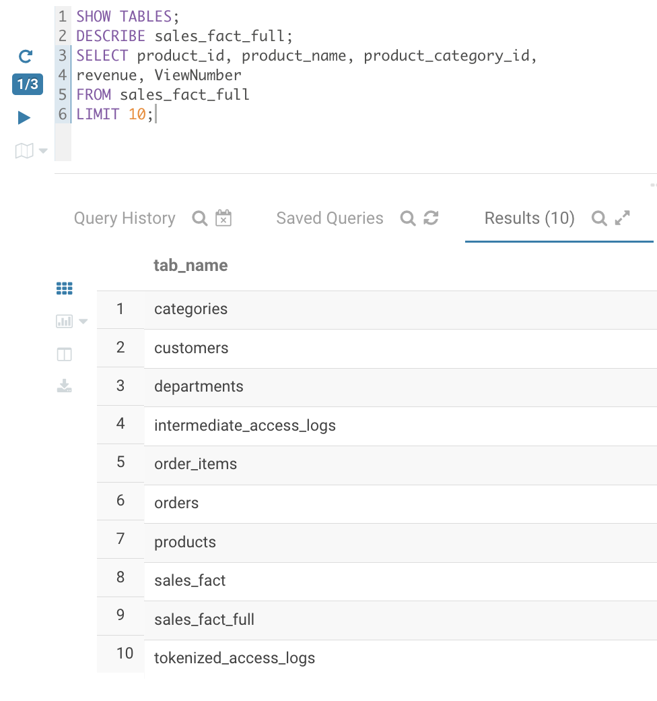

**A2 – Fichier TSV produit par Hive dans HDFS**
Le fichier `/user/cloudera/modeled_data/product_analytics_tsv/000000_0` (4,14 Ko) contient une ligne par produit, avec ses colonnes séparées par des tabulations.

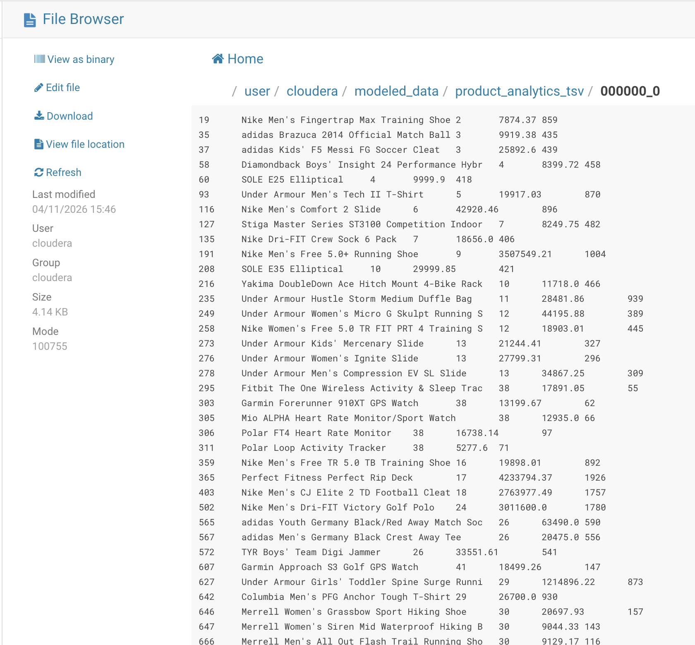

**A3 – Chargement dans HBase avec ImportTsv**
Le job MapReduce se termine avec succès : 75 enregistrements lus et écrits, `Bad Lines=0`.

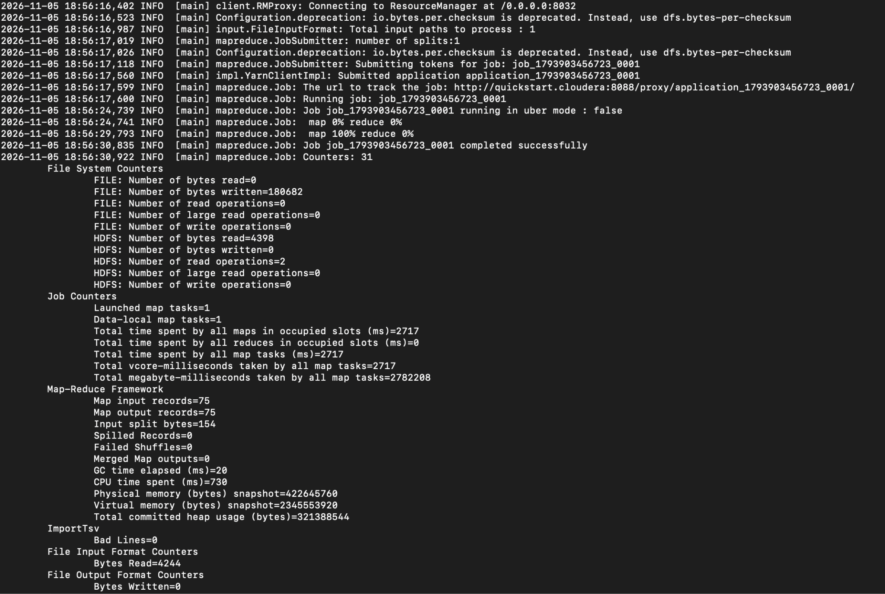

### B. Consultation de la table `product_analytics`

**B1 – Structure de la table**
Deux familles de colonnes, `info` et `metrics`, avec une seule version conservée par cellule (`VERSIONS => '1'`).

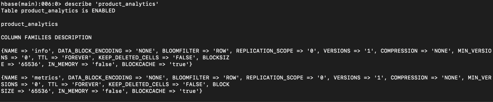

**B2 et B3 – Les dix premières lignes**
Chaque produit (RowKey = `product_id`) occupe quatre cellules. Les RowKeys sont triées comme du texte (`1004` avant `116`).

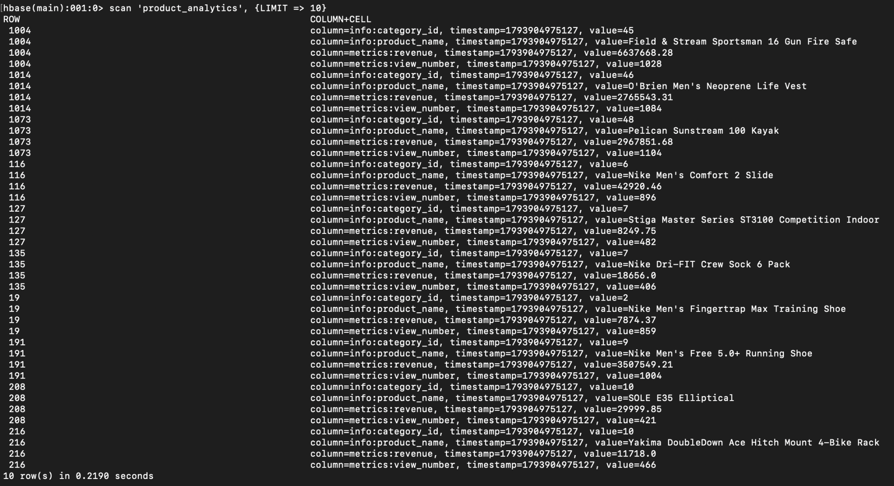

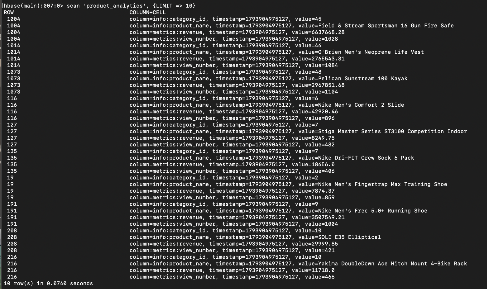

**B4 – Nombre de lignes**
75 produits, soit autant que de lignes dans le fichier TSV.

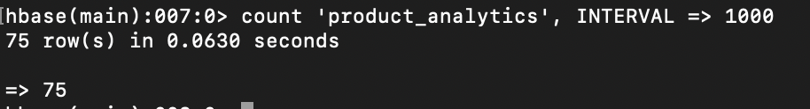

**B5 à B8 – Fiche du produit 1004 par RowKey**
Fiche complète, puis lecture partielle par famille (`info`, `metrics`) et par colonne (`metrics:revenue`). Chaque lecture prend quelques centièmes de seconde.

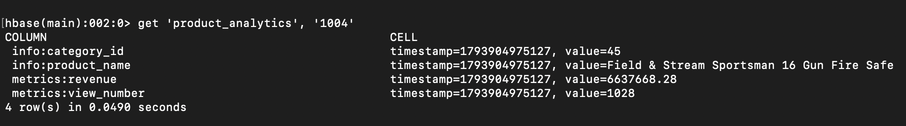

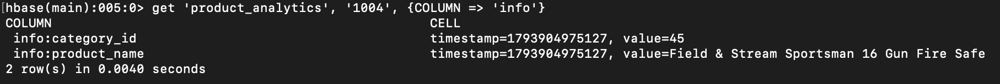

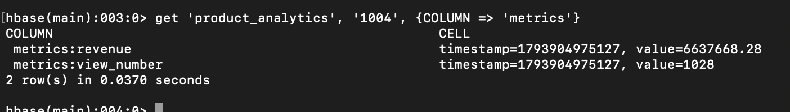

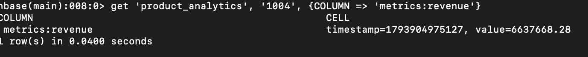

**B9 – Fiche du produit 116**
Nike Men's Comfort 2 Slide : 42 920,46 $ de chiffre d'affaires, 896 vues.

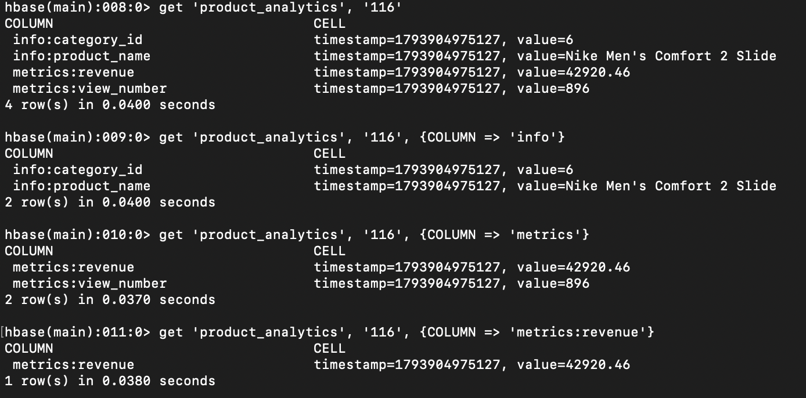

**B10 – Indicateurs de plusieurs produits**
Consultations successives des produits 116, 1004 et 19 : chaque `get` est aussi rapide que le précédent.

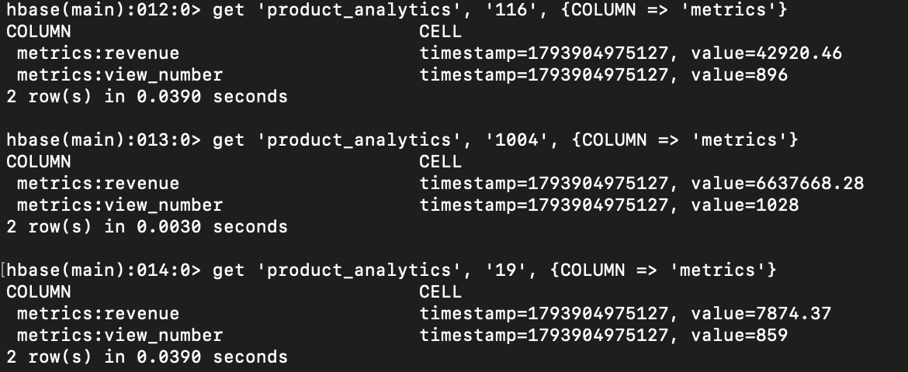

**B11 – Table enrichie pour le projet**
Version de `product_analytics` utilisée par le serveur MCP, avec deux indicateurs supplémentaires : `orders_count` (14 527) et `quantity_sold` (16 595) pour le produit 1004.

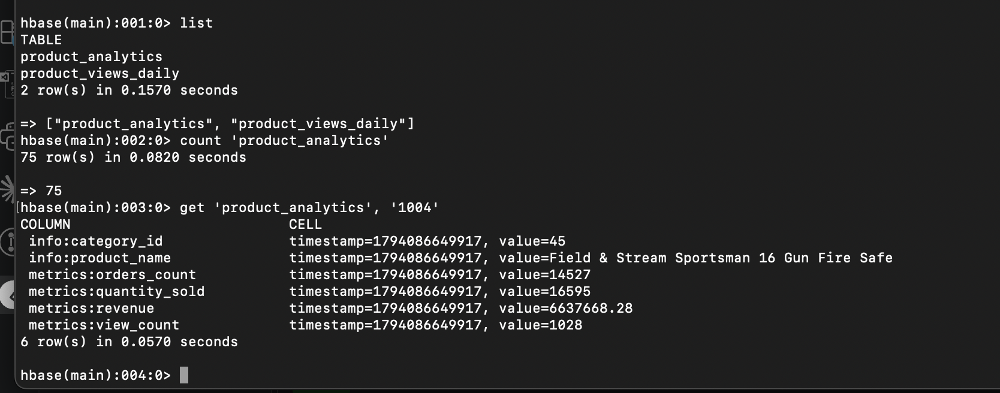

### C. Comparaison avec la source Hive

**C1 – Vérification des indicateurs et du double comptage**
Les valeurs HBase sont identiques à celles calculées par Hive (`revenue`, `view_number` avec `MAX`). La colonne `view_number_somme` montre le résultat erroné obtenu avec `SUM` : le nombre de vues multiplié par le nombre de jours de vente (`nb_jours`).

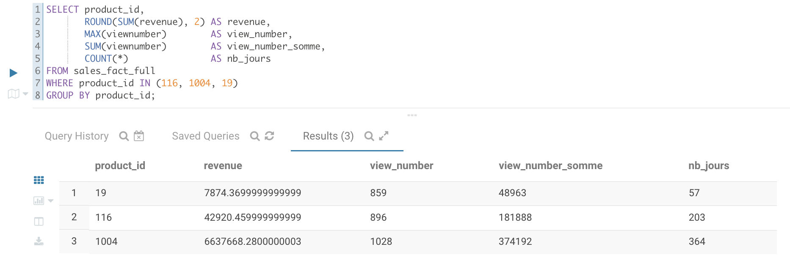

### D. Table journalière `product_views_daily` (RowKey `product_id#YYYYMMDD`)

**D1 – Nombre de lignes**
242 lignes, une par produit et par jour.

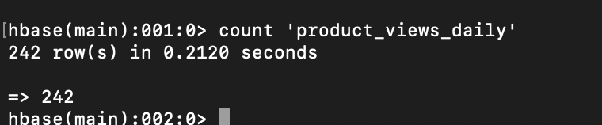

**D2 et D3 – Historique d'un produit par préfixe**
`ROWPREFIXFILTER => '19#'` renvoie les deux journées du produit 19 (307 et 552 vues), triées par date.

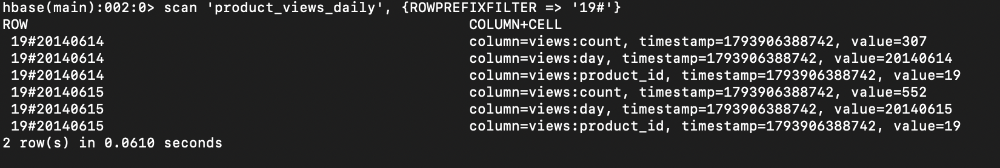

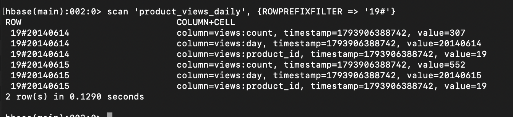

**D4 – Lecture d'un jour et d'une plage de dates**
`get` sur `19#20140615` renvoie 552 vues. La plage `STARTROW => '19#20140614'`, `STOPROW => '19#20140615'` ne renvoie que le 14 juin, car `STOPROW` est exclu.

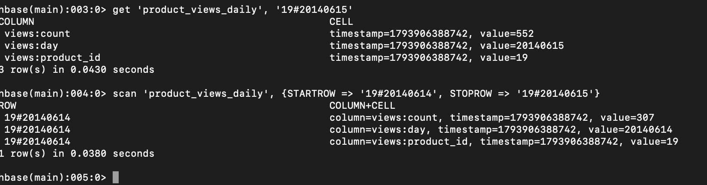

### E. Agent IA dans Streamlit

**E1 – « Quel est le chiffre d'affaires par catégorie ? »**
L'agent appelle l'outil `ca_par_categorie` et présente les résultats sous forme de tableau, en dollars, triés par chiffre d'affaires, avec l'identifiant des catégories homonymes (Electronics 37 et 13).

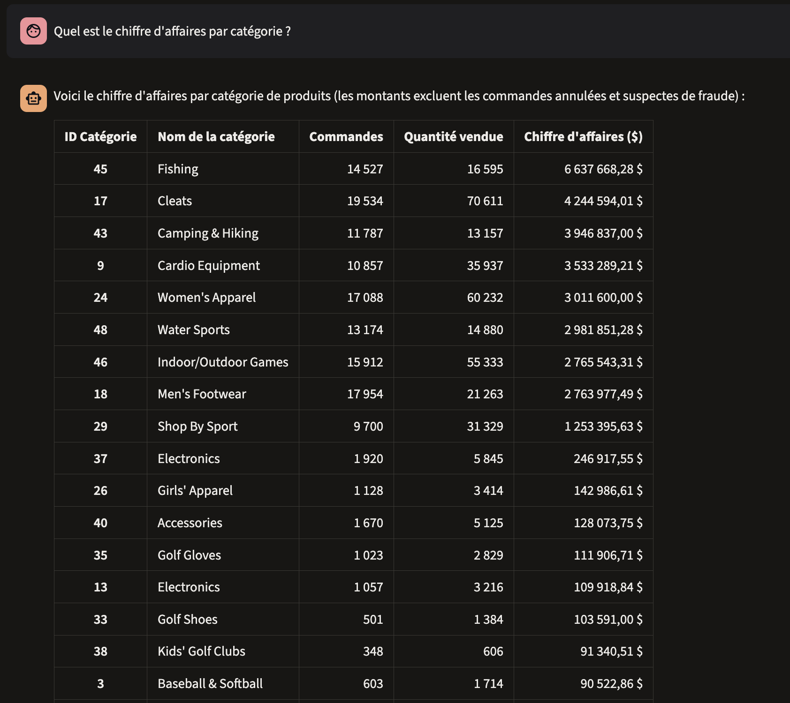

**E2 – Analyse détaillée générée par l'agent**
À partir des mêmes données, l'agent produit une analyse : concentration du chiffre d'affaires sur quelques catégories, et distinction entre catégories à fort volume et catégories à forte valeur unitaire.

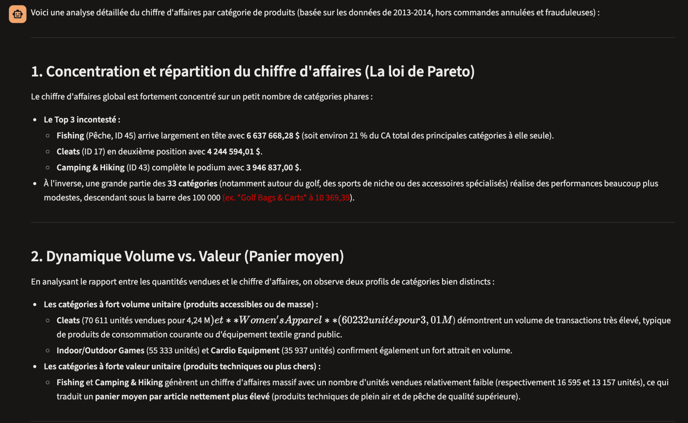
